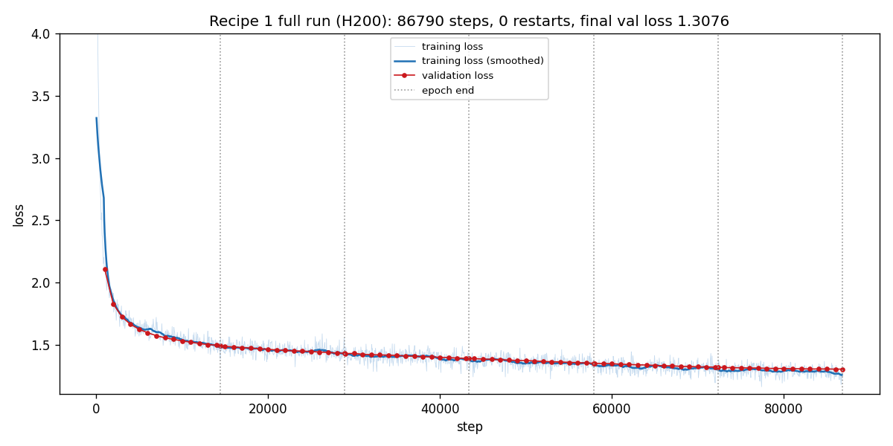
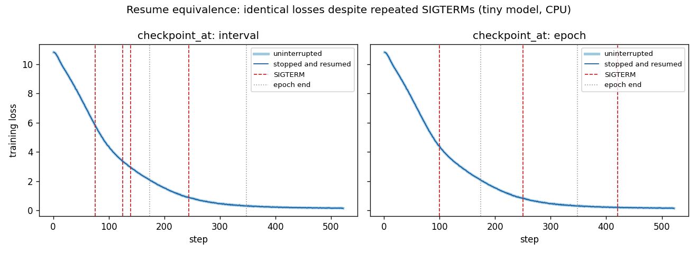
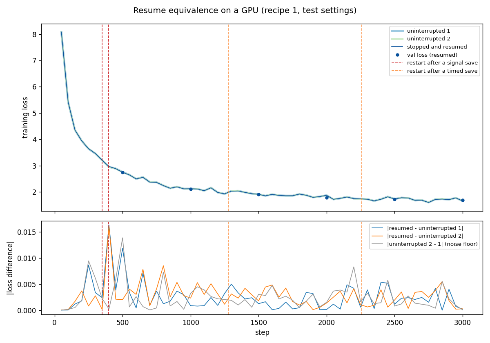

# Recipe 1: a small GPT on TinyStories (one GPU)

A 51M-parameter GPT, trained from scratch on [TinyStories](https://huggingface.co/datasets/roneneldan/TinyStories) for 6 epochs. It takes ~48 minutes on an H200 and ~3.5 hours on an L40. Along the way it can be evicted, held, preempted on backfill or killed outright, and it always picks up where it left off.

Read [recipe 0](../00_minimal/README.md) first: it introduces the five blocks every checkpointing job needs. This recipe keeps those five blocks and adds what a real training job needs: a full training state, two ways to choose *when* to save, several storage setups, and backups. The checkpointing logic comes from the shared modules in [`htcondor_ckpt/`](../../htcondor_ckpt/).

## What you'll learn

- What goes into a **resumable checkpoint**, and how it differs from an **exported model**.
- **Checkpointing at epoch ends vs. during an epoch,** and how to choose.
- What happens, second by second, when HTCondor **stops your job**: a timed exit, an eviction, a hard kill. Measured on CHTC.
- Which **storage setup** to use: spool, spool with `/staging` backups, `/staging`, or the OSPool.
- How to **test** that your job really resumes correctly, on your laptop and on HTCondor.

## Quick start

On the access point, in this directory:

1. **Copy the shared modules here.** The submit files send them with the job:
   ```
   cp -r ../../htcondor_ckpt .
   ```
2. **Build the container** ([`container.def`](container.def): PyTorch 2.8 with CUDA 12.8, plus gcc for `torch.compile`, and tiktoken). Build it in a CHTC interactive build job, then copy `recipe1.sif` to your `/staging` directory:
   ```
   apptainer build recipe1.sif container.def
   ```
   If you rebuild it later, give the new image a new file name: OSDF caches files by name.
3. **Prepare the data once.** This CPU job downloads TinyStories and tokenizes it. It writes `train.bin` and `val.bin` (474M training tokens) to `/staging`.
   ```
   condor_submit prepare.sub
   ```
4. **Put your paths in the submit files.** Replace every `/staging/<user>/...` path: the container image, the data files, and, for the `/staging` modes, the run directory.
5. **Submit:**
   ```
   condor_submit job_chtc.sub
   ```
6. **Watch it:**
   - **`job.out`** collects the output of every run, because HTCondor appends to it across restarts. Look for `SAVED`, `RESUMED from step …` and `DONE`.
   - **`job.log`** shows HTCondor's side of things: evictions, file transfers, restarts.
   - **The results** are in `outputs/` when the job finishes: `best_model.pt`, `samples.txt` (stories written after each epoch) and `metrics.jsonl`. `python3 plot_run.py outputs` draws the loss curve.

Settings live in [`config.yaml`](config.yaml). Override any of them on the command line with `--set name=value`; the submit files do this for the timed-checkpoint interval.

## The files

| File | What it is |
|---|---|
| [`train.py`](train.py) | The training script. Checkpoint code is commented throughout |
| [`model.py`](model.py) | The GPT: pre-LayerNorm, GELU, tied embeddings, `scaled_dot_product_attention` |
| [`config.yaml`](config.yaml) | All settings, with comments |
| [`prepare_data.py`](prepare_data.py), [`prepare.sub`](prepare.sub) | Tokenize TinyStories once, writing to `/staging` |
| [`job_chtc.sub`](job_chtc.sub) | **CHTC, spool mode** (the default). Every line commented |
| [`job_chtc_backup.sub`](job_chtc_backup.sub) | CHTC, spool mode, plus backups on `/staging` |
| [`job_chtc_staging.sub`](job_chtc_staging.sub) | CHTC, checkpoints written straight to `/staging` |
| [`job_ospool.sub`](job_ospool.sub) | OSPool, spool mode |
| [`gpu_check.sub`](gpu_check.sub) | A 1-minute check that the container can use its GPU |
| [`test_local.py`](test_local.py) | Local tests on CPU (no GPU, no HTCondor) |
| [`test_htcondor.sh`](test_htcondor.sh) | HTCondor tests: timed exit, vacate, hold, hard kill, inspect, backup |
| [`compare_runs.py`](compare_runs.py) | Resume equivalence on a GPU: compares a resumed run with uninterrupted runs |
| [`plot_run.py`](plot_run.py) | Plots a run's loss curve from its `metrics.jsonl` |

**Shared modules used** (from [`htcondor_ckpt/`](../../htcondor_ckpt/)):
- `stop.py`: `StopPolicy` (SIGTERM flag, timed exit, vacate window);
- `store.py`: atomic checkpoint directories, `latest` pointer, fallback, retention, backups;
- `meta.py`: `metadata.json`, config hash, Python and NumPy RNG;
- `torch_utils.py`: torch and CUDA RNG, state-dict unwrapping.

## What's in a checkpoint, and why

Each checkpoint is a directory, `checkpoints/step_00012345/`, holding two files:
- **`state.pt`:** everything below, 615 MB;
- **`metadata.json`:** the config and its hash, PyTorch version, save time and duration, and the reason for the save.

`metadata.json` is written last, and only after it is written does the `.tmp` directory get its final name. So a directory without it is never mistaken for a complete checkpoint.

| Saved | Why | What breaks without it |
|---|---|---|
| model weights (`unwrap(model).state_dict()`) | the thing you're training | everything. And saving the `torch.compile` wrapper instead adds `_orig_mod.` to every key, so the plain model can't load it |
| AdamW state (two running averages per weight: 2× the model's size) | the optimizer's memory of past steps | a loss spike after every restart |
| `step` | the learning rate is computed from the step (warmup, then cosine), so no separate scheduler state is needed | wrong learning rate |
| `epoch`, `batch_index` | the position in the data: each epoch's order is rebuilt from `(seed, epoch)`, then skipped ahead `batch_index` batches | repeated or skipped batches |
| `tokens_seen` | progress, for logging and throughput | wrong statistics |
| RNG states: Python, NumPy, torch, CUDA | dropout draws random numbers at every step | a resumed run quietly takes a different path |
| `best_val` | the best validation loss so far | a worse model could overwrite `best_model.pt` |
| `wandb_id` | logging continues the same W&B run (optional, off by default) | a new W&B run per restart |
| `config` | compared at resume: a changed model shape is refused, other changes only warn | silently loading into a different model |

Training uses **bf16 autocast**, so there's no `GradScaler`. On older GPUs with fp16, you'd need a `GradScaler`, and its state would go into the checkpoint too.

**A resumable checkpoint is not your trained model.** `outputs/best_model.pt` is the exported model: just the weights and model config of the epoch with the best validation loss (205 MB). That's the file you keep, share and load for inference. The checkpoints hold everything needed to *continue training*, are three times larger, and get replaced as training goes on. Keep the two apart. And since the model is small and sees the same data six times, validation loss could eventually rise. Then the best model and the latest checkpoint would be different steps.

## Checkpointing at epoch ends vs. during an epoch

`checkpoint_at` in `config.yaml` chooses between them:

| | `interval` (default) | `epoch` |
|---|---|---|
| Saves | whenever a stop is requested: SIGTERM, the timed exit, mid-epoch if need be | only at epoch ends |
| A SIGTERM mid-epoch | finish the current step, save, exit 85. Nothing is lost | exit 85 *without saving*. The restart redoes the epoch from its start |
| The timed exit | saves at once | waits for the end of the epoch (but an eviction still interrupts the wait) |
| Data position | `(epoch, batch_index)` | just `epoch` |
| Work lost at an eviction | none | up to one epoch |

Epoch-only checkpointing is simpler, and that's fine **when an epoch is short compared with the work you can afford to redo.** Here an epoch takes 7.5 minutes on an H200 and 35 on an L40, so `epoch` mode would be acceptable. In recipes 2 and 3 an epoch takes hours, or there's only one, so they save mid-epoch. If your epochs are longer than about an hour, use `interval`.

Both modes pass the same resume-equivalence test (below).

## What happens when HTCondor stops your job

Measured on CHTC GPUs with this recipe (615 MB checkpoints, spool mode):

**Timed checkpoint** (`max_runtime_seconds`: every 6 hours in `job_chtc.sub`, 5 in `job_ospool.sub`):
```
timer fires → finish the step → save (2.5–4.4 s) → exit 85
  → HTCondor copies the checkpoint to the access point (≤ 2 s) → restarts the job in place (~4 s)
  → start-up: imports, data, model, load, torch.compile (~11 s) → training continues
```
**About 18–20 s in all, ~0.1% of a 6 h interval.**

The whole run takes 48 minutes on an H200 and 3.5 hours on an L40, so on fast GPUs **the timed exit never fires.** It's insurance for slower GPUs, longer runs and hard kills.

**Eviction** (`condor_vacate_job`, `condor_hold`, the GPU's owner reclaiming a backfill slot, and, per CHTC's policy, reaching the GPU job-length limit with `+is_resumable`):
```
SIGTERM → finish the current step → save (4–12 s) → exit 85
  → HTCondor copies the checkpoint back (when_to_transfer_output = ON_EXIT_OR_EVICT)
  → the job waits for a new slot, often on another machine (55–116 s in our tests, including ~16 s of input transfer)
  → start-up (~19 s: a fresh sandbox has no torch.compile cache) → resumes from the save made after SIGTERM
```
**No work is lost.** HTCondor allows 600 s from SIGTERM to SIGKILL; `train.py` logs how much of it is left when the save starts and when it finishes ("save finished with 587 s left before SIGKILL").

**A real backfill eviction** hit two of our test jobs while they ran on the same machine: "PREEMPT expression evaluated to True" in the event log. Both saved and resumed elsewhere. Their saves took 12.4 s instead of the usual 2.5–5.6 s, probably because both jobs wrote to the same disk at once.

**Hard kill** (`condor_vacate_job -fast`, a machine crash, an OSPool glidein ending):
```
SIGKILL, no warning → the job restarts from its last timed checkpoint (in spool mode)
                      or its last periodic save (in /staging mode)
```
The work since that save is lost. The timed interval sets the most you can lose.

## Choosing a storage mode

| | Submit file | Where checkpoints live | Use it for |
|---|---|---|---|
| **Spool** | `job_chtc.sub`, `job_ospool.sub` | HTCondor keeps them on the access point between runs | checkpoints up to a few GB; CHTC and the OSPool. The default here |
| **Spool + `/staging` backups** | `job_chtc_backup.sub` | spool, plus copies on `/staging` at timed checkpoints | runs longer than about half a day (see below). CHTC only |
| **`/staging`** | `job_chtc_staging.sub` | `/staging/<user>/<run>/checkpoints`, written directly | large checkpoints (recipes 2–3), or when you want saves every 15 min without exiting. CHTC only |

**Spool mode** needs four lines, and each one matters. They're all commented in [`job_chtc.sub`](job_chtc.sub):
```
checkpoint_exit_code      = 85                   # exit 85 = "saved, restart me"
transfer_checkpoint_files = checkpoints, outputs # what HTCondor keeps between runs
when_to_transfer_output   = ON_EXIT_OR_EVICT     # also keep them at an eviction
transfer_output_files     = checkpoints, outputs # directories are only copied back if named
```
Without `ON_EXIT_OR_EVICT`, the save made after SIGTERM is thrown away. Without the directories in `transfer_output_files`, it never leaves the execute point. We measured both. `outputs/` travels too, so the metrics log, sample stories and best model continue across restarts.

**Spool checkpoints disappear with the job.** `condor_rm`, a removal policy or resubmitting all start you from scratch. **Backups** protect against that:
- `--set backup_dir=/staging/<user>/<run_name>/backups` copies the checkpoint there at timed checkpoints, keeping 2.
- At startup the job resumes from whichever is newer, the spool or the backups. So a resubmitted job with the same `backup_dir` continues.
- Name the folder after the run, not the job id.
- Backups never happen after a SIGTERM: those 600 s are for the main save.
- A backup costs little: copying the 615 MB checkpoint to `/staging` took 2.96 s in our backup test.

How often to back up (from [`htcondor_ckpt/README.md`](../../htcondor_ckpt/README.md)):

| How long the whole run takes | Back up to `/staging` |
|---|---|
| fits in one or two timed intervals (under ~12 h): **this recipe** | not needed |
| up to about a day | at every timed checkpoint |
| 1–3 days | about every 12 hours |
| longer | every 12–24 hours |

**`/staging` footprint** for `job_chtc_staging.sub`, which keeps 2 checkpoints:

| Item | Size |
|---|---|
| 2 × 615 MB, plus one being written | ~1.9 GB |
| `outputs/` (best model, metrics, samples) | 0.2 GB |
| **Total** | **about 2.1 GB in about 10 files** |

That's far inside the default `/staging` quota of 100 GB and 1,000 files. In `/staging` mode, the in-place saves every 15 minutes are durable at once, so a hard kill loses at most 15 minutes.

**On GPUs:**
- **`+is_resumable = true`** lets the job run on backfill slots, which GPU owners reclaim when they need them. It also turns hitting the `+GPUJobLength` limit into an eviction rather than a hold.
- **To run only on backfill,** uncomment `requirements = (TARGET.BackfillSlot =?= true)`. Check the `BackfillSlot` attribute, not the slot name: names vary by machine.
- **Backfill GPUs vary more than GPU Lab ones.** The job needs 15.4 GB of GPU memory (measured on an H200), so the submit files set `gpus_minimum_memory = 20000` (MB). Without it, the job once landed on an 11 GB card and ran out of memory. To require a newer GPU, add `gpus_minimum_capability = 8.0`.

## Results

**The full run** (`job_chtc.sub`, NVIDIA H200, uninterrupted):

| | |
|---|---|
| Steps | 86,790 (6 epochs × 14,465 steps of 64 × 512 tokens) |
| Throughput | 1.06M tokens/s on an H200; 224k on an L40 |
| Time | 48 min on an H200 (7.5 min per epoch); ~3.5 h on an L40 |
| Start-up to the first step | 20 s, including `torch.compile` |
| Peak GPU memory | 15.4 GB |
| Validation loss after epochs 1–6 | 1.4935, 1.4351, 1.3935, 1.3543, 1.3226, **1.3076** |
| Checkpoint | 615 MB, 2 files, saved in 0.6–5.6 s (12.4 s when two jobs saved at once) |



**Sample stories** from the same prompts, after epoch 1 and after epoch 6 (from `outputs/samples.txt`, cut off at the length limit):

> **Epoch 1:** The dog wanted to play, but he was scared. He tried to find his owner, but they were too far away. The dog became very sad and lonely. He went home and cried. The moral of the story is to be careful and not go too far away. It's important to ask for help when you need it, and not be too greedy.

> **Epoch 6:** One day, a little girl named Lily found a magic book. She wanted to read it. Lily asked her mom, "Can I read this book?" Her mom said, "Yes, but be careful. It is a very important book." Lily read the book. It was a story about a little girl who went on an adventure…

## Testing that resumes are correct

### On your laptop (CPU, ~4 minutes)

```
pip install torch numpy pyyaml matplotlib   # all the local tests need (no data download, no tokenizer)
python3 test_local.py
```

The script uses a tiny model and made-up data. It checks that:
- **Resume equivalence:** a run stopped with SIGTERM at several random steps logs **exactly the same losses** as an uninterrupted run, in both `checkpoint_at` modes;
- **timed checkpoints:** they save mid-epoch in `interval` mode and wait for the epoch end in `epoch` mode;
- **a damaged newest checkpoint:** the job warns and resumes from the previous one;
- **backups:** a "resubmitted" job (an empty sandbox) resumes from the backup directory;
- **config changes:** a changed model shape is refused, while other changes only warn.



### On HTCondor GPUs

Set your locations, then run one test at a time or several in parallel. Each takes 10–15 minutes of one GPU:
```
export RECIPE1_IMAGE=osdf:///chtc/staging/<user>/<path>/recipe1.sif
export RECIPE1_DATA_DIR=/staging/<user>/tinystories
export RECIPE1_TEST_DIR=/staging/<user>/recipe1-tests

./test_htcondor.sh job_chtc.sub timed          # timed exits: each resumes, and the run finishes
./test_htcondor.sh job_chtc.sub vacate         # resumes from the save made after SIGTERM
./test_htcondor.sh job_chtc.sub hold           # condor_hold + condor_release: the same
./test_htcondor.sh job_chtc.sub fast           # hard kill: resumes from the last timed checkpoint
./test_htcondor.sh job_chtc.sub inspect        # copies out the kept checkpoint (condor_evicted_files)
./test_htcondor.sh job_chtc_staging.sub vacate # /staging mode
./test_htcondor.sh job_chtc_backup.sub backup  # condor_rm once a backup exists, resubmit: resumes from it
./test_htcondor.sh job_ospool.sub timed        # the OSPool
```
- **How each test works:** it reads only its job's event log, sends one HTCondor command, and prints the job's `SAVED` and `RESUMED` lines with a PASS or FAIL.
- **Status:** all of these passed on CHTC and the OSPool.
- **Test settings:** 3,000 steps with a short pause after each, and a timed exit every 2 minutes, so the tests can interrupt the run several times.

**Resume equivalence on GPUs.** Run two uninterrupted references and one interrupted run, then compare them:
```
./test_htcondor.sh job_chtc.sub reference &
./test_htcondor.sh job_chtc.sub reference &
./test_htcondor.sh job_chtc.sub vacate
wait
python3 compare_runs.py --reference <ref 1>.outputs --reference <ref 2>.outputs \
    --resumed <vacate>.outputs --plot resume_equivalence_gpu.png
```
Each test prints its directory names when it finishes; use them in place of the `<…>` placeholders.



**Our result** (from the run in the plot):
- **The interrupted run:** an H100 on backfill. It went through 4 restarts: a real backfill eviction, our `condor_vacate_job`, and 2 timed exits.
- **The references:** an H200 and an RTX PRO 6000 Blackwell.
- **What it shows:** the interrupted run stays as close to the references as the references stay to each other.

| Comparison | Largest val-loss difference | At step 3000 |
|---|---|---|
| reference vs. reference | 0.0053 | 0.0001 |
| resumed vs. references | 0.0068 | 0.0009–0.0010 |

**Why GPUs don't give the CPU test's exact match:** even the two uninterrupted runs differ from step 50 on. Different GPU models run different kernels, `torch.compile` tunes each device differently, and small bf16 rounding differences then grow. `deterministic=true` makes a run repeatable on the *same* hardware, but a resumed job may land on any GPU.

**So the test passes if** the largest validation-loss difference is under 0.01, or under twice the reference-to-reference difference if that's bigger.
- **Why validation loss:** it's measured on the same 20 batches every time, so it's far less noisy than the loss of a single training batch.
- **Why the largest difference, not the last:** the damage from a bad resume can fade as training goes on.

A real bug looks different. Lost optimizer state, a wrong learning rate or a repeated batch shows up as a jump right after a restart line in the plot, and it doesn't close again.

### Inspecting a checkpoint

The same workflow as [recipe 0](../00_minimal/README.md#inspecting-your-checkpoint): `condor_vacate_job`, `condor_hold`, `condor_evicted_files get <job>`, then `condor_release`. `./test_htcondor.sh job_chtc.sub inspect` runs it.

`condor_ssh_to_job` is turned off for GPU jobs on CHTC, so this is the way to look inside one.

## Adapting this to your own model

- **Replace `model.py` and the data loader.** Keep the data position resumable: either rebuild each epoch's order from `(seed, epoch)` and skip `batch_index` batches, as `TokenData` does, or save your loader's state (for example `torchdata`'s `StatefulDataLoader`).
- **Trace every saved field** from `save()` to the resume block in `train.py`. Anything that changes during training must be in both: an LR scheduler object, a `GradScaler`, an EMA of the weights.
- **Measure your save time and checkpoint size.** `train.py` prints both at every save. Keep the save well inside 600 s. If checkpoints grow beyond a few GB, switch to `/staging` mode.
- **Measure the cost of one timed checkpoint** (save + transfer + start-up, all in `job.out` and `job.log`). Keep it small compared with the interval: CHTC usually suggests 6–10 h on backfill and 4–6 h on the OSPool (up to 8).
- **Choose `checkpoint_at`:** `epoch` if an epoch is short compared with what you can afford to lose, `interval` otherwise.
- **Set a GPU memory floor** from your peak memory (printed on the first step), with some room to spare.
- **Keep `exec`** in front of your command in the `shell` line, so Python is the process HTCondor signals.
