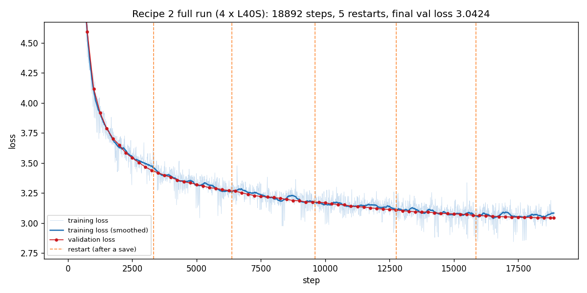
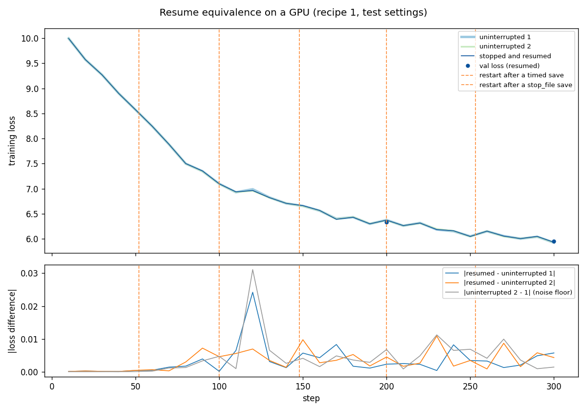

# Recipe 2: GPT-2 small on FineWeb-Edu (one node, several GPUs, DDP)

GPT-2 small (124M parameters), trained from scratch on 10B tokens of [FineWeb-Edu](https://huggingface.co/datasets/HuggingFaceFW/fineweb-edu) with PyTorch DistributedDataParallel on up to 4 GPUs of one machine. The full run takes 3.7–6.3 hours on 4 GPUs. Along the way it stops and restarts several times, and every GPU has to stop together each time.

Read [recipe 1](../01_tinystories/README.md) first. It explains what a checkpoint contains, the timed exit, storage modes and backups. This recipe keeps all of that and adds what changes with several GPUs.

## What's new compared with recipe 1

- **Several processes, one decision.** Each GPU has its own training process (a *rank*). They must all stop at the same step, or the job deadlocks.
- **A launcher between HTCondor and your code.** `torchrun` starts the ranks. Started directly, it breaks HTCondor's stop signal and exit code 85. A small wrapper, [`launch.py`](../../htcondor_ckpt/launch.py), fixes both.
- **Rank 0 saves, every rank loads.** One checkpoint, written by one process, holding every rank's random-number state.
- **Steps and tokens, not epochs.** One pass over 10B tokens is the whole run, so the checkpoint records a position in the data (`pass, shard, sequence`) and saves mid-pass.
- **A run that spans many executions.** Timed exits every hour (a demonstration value, see below), periodic saves on `/staging`, and evictions, all in one continuous loss curve.
- **A mixed pool of GPUs.** The job may land on different GPU types, with or without NVLink, and resume on a different type than it started on.

Multi-node training (HTCondor's parallel universe) is out of scope here: it adds complexity unrelated to checkpointing. It may become a later recipe.

## Quick start

On the access point, in this directory:

1. **Copy the shared modules here** (the job sends them along):
   ```
   cp -r ../../htcondor_ckpt .
   ```
2. **Use recipe 1's container.** [`../01_tinystories/container.def`](../01_tinystories/container.def) has everything this recipe needs: PyTorch 2.8 with CUDA 12.8, gcc for `torch.compile`, tiktoken, datasets. If you haven't built it yet, see recipe 1's quick start.
3. **Prepare the data once.** This CPU job downloads FineWeb-Edu's 10B-token sample and tokenizes it into shards on `/staging`. It took 18 minutes on 16 CPUs and writes 19.9 GB in 108 files:
   ```
   condor_submit prepare.sub
   ```
   It can be interrupted safely: a restarted job skips the input files it has finished (`manifest.json` records them).
4. **Put your paths in [`job.sub`](job.sub):** `DATA_DIR` (the shards), `RUN_DIR` (where this run's checkpoints and outputs go) and `container_image`.
5. **Submit:**
   ```
   condor_submit job.sub                      # 4 GPUs
   condor_submit job.sub -a "NGPUS = 2"       # or fewer
   ```
6. **Watch it.** `job_run1.out` collects every execution's output:
   ```
   grep -E "^(STARTING|RESUMED|SAVED|DONE)|stop:|communication" job_run1.out | tail
   ```
   The metrics log is in `RUN_DIR/outputs/metrics.jsonl`. `python3 plot_run.py <RUN_DIR>/outputs` draws the loss curve, with each restart marked.

## The files

| File | What it is |
|---|---|
| [`train.py`](train.py) | The training script: DDP, stop agreement, rank-0 saves, the shard loader |
| [`model.py`](model.py) | Recipe 1's GPT, with GPT-2 small's defaults |
| [`config.yaml`](config.yaml) | All settings, with comments |
| [`prepare_data.py`](prepare_data.py), [`prepare.sub`](prepare.sub) | Tokenize FineWeb-Edu into shards on `/staging` (resumable) |
| [`job.sub`](job.sub) | The training job, `/staging` mode. Every line commented |
| [`test_local.py`](test_local.py) | Local tests on CPU: one process, and 2 ranks under `launch.py` + `torchrun` (`--ddp`) |
| [`test_htcondor.sh`](test_htcondor.sh) | HTCondor tests: communication check, timed exit, vacate, hold, hard kill, reference runs |
| [`compare_runs.py`](compare_runs.py), [`plot_run.py`](plot_run.py) | Resume equivalence against two uninterrupted runs; one run's loss curve |

**Shared modules used** (from [`htcondor_ckpt/`](../../htcondor_ckpt/)):
- `stop.py`: `StopPolicy` (SIGTERM or stop file, timed exit, vacate window);
- `store.py`: atomic checkpoint directories, `latest`, fallback, retention;
- `meta.py`: `metadata.json`, config hash, Python and NumPy RNG;
- `torch_utils.py`: `agree_max()` for the stop agreement, per-GPU RNG, unwrapping DDP and `torch.compile`;
- `launch.py`: the stop-file wrapper around `torchrun`.

## Why every rank must agree to stop

Every training step ends with an all-reduce: the ranks average their gradients, and each waits until all the others have joined. If one rank stops and the others don't, those others wait forever:

```
rank 0:  step 500 ... sees the stop file → saves → exits
rank 1:  step 500 ... hasn't looked yet  → step 501: all-reduce ... waits for rank 0 ... forever
```

Each rank sees its own signal, its own stop file check and its own clock, so they can notice a stop at different steps. So `train.py` makes one decision for all of them. At the end of every step, each rank says what it sees, as a number ordered by urgency (0 = go on, 1 = periodic save due, 2 = timed stop, 3 = stop file, 4 = SIGTERM), and one tiny all-reduce takes the maximum:

```python
level = torch_utils.agree_max(stop_level())   # every rank gets the same answer
if level >= STOP_FILE:  handle_eviction(level)     # save, exit 85
elif level == TIMED:    save("timed"); exit_for_restart("timed")
elif level == PERIODIC: save("periodic")
```

Every rank then does the same thing at the same step, for the same reason. The check also runs between the micro-batches of a step (gradient accumulation), so an eviction never waits for a whole step. The partial step is thrown away, and the checkpoint is the state after the last completed step.

**The save itself:** every rank sends its random-number state to rank 0. Rank 0 writes one checkpoint, and all ranks wait at a barrier until it's done. Only then do they exit together. Otherwise a rank that exits early makes `torchrun` stop the others, rank 0 included, possibly mid-save.

## How the stop request reaches your training processes

HTCondor signals only the job's top process (measured: [docs/environment.md](../../docs/environment.md) §6). With several GPUs that's the launcher, not your code. Plain `exec torchrun` then breaks in two ways. Both were measured under HTCondor with torch 2.14, and again locally with torch 2.8, this recipe's version:

1. **torchrun passes SIGTERM on to the workers, then kills them about 30 s later.** A save that takes longer is cut off.
2. **torchrun turns a worker's exit 85 into 1.** HTCondor then thinks the job finished (or failed) instead of restarting it.

So the job starts a small wrapper, which starts `torchrun`:

```
shell = export HOME=$PWD; exec python3 htcondor_ckpt/launch.py -- torchrun --standalone --nproc_per_node=$(NGPUS) train.py ...
```

```
HTCondor --SIGTERM--> launch.py --creates--> STOP_REQUESTED (file; the signal is NOT passed on)
                         |                          ^
                         └── torchrun ── rank 0..N ─┘ each rank checks for the file every step
                                                      → agree, save, exit 85
                         torchrun exits 1 → launch.py sees the ranks' restart notes → exits 85
```

It depends on no `torchrun` feature or version, and works the same with other launchers (`accelerate`, `deepspeed`, `mpirun`).

**Measured under HTCondor** (2 GPUs, 2026-10-22):
- **`condor_vacate_job` on H200s:** the stop arrived between micro-batches 2 and 3. Both ranks stopped at step 160, rank 0 saved 1.5 GB in 5.2 s with 595 s of the 600 s window left, and `launch.py` exited 85.
- **`condor_hold` on L40S:** the same. After `condor_release`, the job resumed on **A100-40GB**, a different GPU type.
- **A real backfill eviction on L40:** the same path.

Locally (`test_local.py --ddp`), a 40 s save completes under `launch.py` and is cut off under plain `torchrun`.

**Alternative on recent PyTorch:** `torchrun --shutdown-timeout 420` (or `TORCH_ELASTIC_SHUTDOWN_TIMEOUT=420`) lengthens torchrun's grace period. It worked in torch 2.14. You still need something to turn torchrun's exit 1 into 85, which `launch.py` does anyway.

## Choosing the timed-exit interval

This recipe exits and restarts **every hour** (`max_runtime_seconds: 3600`). That's a **demonstration value**, chosen so that the full run, a few hours on 4 GPUs, restarts several times and you can watch the workflow. For real runs, CHTC suggests **6–10 hours on backfill** and **4–6 hours (up to 8) on the OSPool**. An eviction gets its own save after SIGTERM, so the interval only limits what a hard kill (no warning) can take.

**What one timed checkpoint costs here** (full run, 4 × L40S, restarting in place):

| Save (1.5 GB) | Exit → new process | Start-up → first step | Total |
|---|---|---|---|
| 4.9–6.7 s | 7–8 s | 21–32 s (incl. `torch.compile`, 4 ranks) | **33–39 s** |

That's about 1% of the 1 h demo interval, and 0.2% of a 6 h one.

Once in the full run, HTCondor *rescheduled* the job instead of restarting it in place (event log: `Code 1025`). It came back on the same machine **18 minutes** later. That's rare, but it's another reason not to make the interval too short.

## Storage: `/staging`

The checkpoints (1.5 GB: fp32 weights plus AdamW's two running averages) are written straight to `/staging`, so each save is safe the moment it's written. In-place saves every 30 minutes (`save_every_minutes`) protect against hard kills between timed exits, and 2 checkpoints are kept as a fallback. The data is read straight from `/staging` too, memory-mapped: reading took 0.1% of the training time, so nothing big is transferred.

**`/staging` footprint:**

| | Size | Files |
|---|---|---|
| Data: 106 training shards + validation + `manifest.json` | 19.9 GB | 108 |
| A run: 2 checkpoints + 1 being written + best model + metrics | ~5 GB | ~10 |
| **Total** | **~25 GB** | **~120** |

That's within the default quota of 100 GB and 1,000 files. A run's checkpoints live in `RUN_DIR`: resubmitting with the same `RUN` name resumes it, and a new name starts fresh.

Spool mode (recipe 1's default) would also work for a 1.5 GB checkpoint: HTCondor moved 1 GB in about 5 s in our probes. This recipe doesn't include a spool submit file. Use recipe 1's four spool lines, and set `save_every_minutes: 0`.

## Running on a mixed pool of GPUs

The job asks for GPUs by their properties, never by machine name. It runs on whatever matches:

```
gpus_minimum_memory     = 30000M    # 23.8 GB measured peak per GPU, plus headroom
gpus_minimum_capability = 8.0       # bf16 needs Ampere or newer
environment             = "NCCL_P2P_LEVEL=NVL"
```

On CHTC that's A100s, A40, L40/L40S, H100/H200 and RTX PRO 6000s. Things to know:
- **Some machines without NVLink hang** at the first all-reduce when NCCL copies directly between GPUs over PCIe. We measured this on RTX PRO 6000 machines; direct copies over PCIe worked on L40.
  - **The fix:** `NCCL_P2P_LEVEL=NVL` lets NCCL copy directly only over NVLink, and through host memory otherwise.
  - **The cost:** it's slower where direct PCIe copies would have worked. That's probably part of why 4 × L40S trained at 491k tokens/s against 740k on 4 NVLink A100s.
- **A start-up check catches a broken machine.** `train.py` runs one all-reduce at start-up and prints `communication OK`. If the GPUs can't talk, the job stops after `collective_timeout_seconds` (300 s) with a clear message, instead of hanging.
- **Smaller GPUs:** lower `micro_batch` in `config.yaml`. Gradient accumulation keeps every step at 524,288 tokens, so training is unchanged.
- **Not tested: A100s split into MIG instances.** One machine offers these 40 GB slices, and they meet the memory and capability floors. As far as we know, NCCL can't connect MIG instances to each other, so a multi-GPU job that got two of them would fail at the start-up check. `require_gpus = !regexp("MIG", DeviceName)` should exclude them.
- **Resuming on a different GPU type is fine.** The numbers stop matching bit for bit, at the level of normal run-to-run noise (see Results).

## Results

**The full run** (`job.sub`, 4 × L40S on a backfill slot, 2026-10-22):

| | |
|---|---|
| Steps, tokens | 18,892 steps × 524,288 tokens = 9.90B tokens, one pass |
| Wall time | 6.3 h in 6 executions (5 timed exits) |
| Throughput | 491k tokens/s on 4 × L40S (median); 740k on 4 × A100-SXM4-80GB (smoke run) |
| Validation loss | 6.13 at step 250 → **3.04** at the end |
| Peak GPU memory | 23.8 GB per GPU at `micro_batch` 32 |
| Checkpoint | 1.5 GB, 2 files, saved in 4.9–6.7 s |



**Throughput by GPU count** (smoke runs, A100-SXM4-80GB): 206.5k tokens/s on 1 GPU and ~740k on 4, so 3.6× (~90% scaling). The full run would take about 13 h on 1 A100 and 3.7 h on 4.

**Resume equivalence on GPUs** (`compare_runs.py`, 300 steps, 2 GPUs):
- **The runs:** two uninterrupted references on H100s, and a run with 5 restarts (4 timed exits, 1 `condor_vacate_job`) on A100-40GB.
- **The two references differed from step 30 on, by up to 0.0061** in validation loss. That's the normal noise between identical runs on GPUs, even of the same type.
- **The resumed run differed from them by up to 0.0090,** within twice that noise. The test passes.
- **With one GPU type and deterministic settings,** a resumed run matches exactly: the CPU tests in `test_local.py` match bit for bit.



**1 GPU vs 4 GPUs** with the same global batch (smoke runs): validation loss 6.3194 vs 6.3262 after 200 steps, 0.0068 apart. This is an informal check with one run each, not the two-reference test.

## Testing

**Locally** (CPU, no GPU or HTCondor; about 2 minutes, plus about 5 with `--ddp`):
```
pip install torch numpy pyyaml    # and importlib-metadata on Python 3.9, which torchrun needs there
python3 test_local.py          # one process
python3 test_local.py --ddp    # also 2 ranks under launch.py + torchrun
```
- **One process:**
  - SIGTERMs at step boundaries and at random moments, including between micro-batches: losses identical to an uninterrupted run;
  - a timed exit;
  - shards too small for a step are skipped.
- **Two ranks (`--ddp`):**
  - a SIGTERM sent to `launch.py` only stops both ranks at the same step, and the resume matches the uninterrupted run exactly;
  - 2 ranks match 1 process (within 2e-6);
  - a 40 s save completes under `launch.py` and is cut off under plain `torchrun`;
  - resuming on a different number of ranks gives a warning.

On a Mac, the test starts `torchrun` with an explicit local address, because `--standalone` can hang where the host name doesn't resolve.

**On HTCondor:**
```
export RECIPE2_IMAGE=osdf:///chtc/staging/<user>/<path>/recipe1.sif
export RECIPE2_DATA_DIR=/staging/<user>/recipe2/fineweb10B
export RECIPE2_TEST_DIR=/staging/<user>/recipe2/tests

nohup ./test_htcondor.sh comm   > comm_run.txt 2>&1 &     # can the GPUs communicate? (~3 min)
nohup ./test_htcondor.sh vacate > vacate_run.txt 2>&1 &   # every rank stops at the same step, resumes from that save
nohup ./test_htcondor.sh hold   > hold_run.txt 2>&1 &     # condor_hold + condor_release: the same
nohup ./test_htcondor.sh fast   > fast_run.txt 2>&1 &     # hard kill: resumes from the last periodic/timed save
nohup ./test_htcondor.sh reference > ref_run.txt 2>&1 &   # uninterrupted, for compare_runs.py
```
- **How each test works:** it uses `job.sub`'s own command, with test settings: 2 GPUs, 300 steps, a timed exit every 2 minutes. It waits until the job is training (not saving or restarting) before interrupting it, and ends with PASS or FAIL. Each takes 10–15 minutes, about 0.3–0.5 GPU-hours.
- **Extra arguments go to `condor_submit`,** e.g. `-a "gpus_minimum_capability = 12.0"` to test only Blackwell GPUs.
- **`nohup`** keeps a test running after you log out. A stopped test leaves its job in the queue, so `condor_rm` it before retrying.

**How many times has my job restarted?** Look at the `RESUMED` lines in the job's `.out` (or the `resumed` events in `metrics.jsonl`), and the event log for evictions (`004`). Don't use `NumJobStarts`: it doesn't count exit-85 restarts.

## Adapting this to your own DDP code

- [ ] **Start through a wrapper,** not with plain `exec torchrun` (or `accelerate`/`deepspeed launch`): `exec python3 launch.py -- <your launcher command>`.
- [ ] **Watch for the stop file in every rank.** `StopPolicy` reads its path from the environment `launch.py` sets, and also catches SIGTERM for 1-GPU runs without a launcher.
- [ ] **Make one stop decision for all ranks** with an all-reduce (`torch_utils.agree_max()`), at every step boundary, and between micro-batches if a step is long.
- [ ] **Have rank 0 save and every rank load.** Gather every rank's RNG state first. Put a barrier after the save, so no rank exits while rank 0 is writing.
- [ ] **Save the plain model's state dict,** inside both DDP's `.module` and `torch.compile`'s wrapper (`torch_utils.unwrap()`), so the checkpoint loads into any wrapping.
- [ ] **Keep the data position independent of the GPU count:** count sequences for all GPUs together, as `(pass, shard, sequence)` does here. Or save your loader's state per rank.
- [ ] **Keep the global batch fixed with gradient accumulation,** so changing GPU type or `micro_batch` doesn't change training.
- [ ] **Describe the GPUs you need by their properties,** not machine names: memory, capability, and `NCCL_P2P_LEVEL=NVL` for machines without NVLink.
- [ ] **Measure your save time and start-up time,** and choose the timed-exit interval from them: 6–10 h on backfill.
