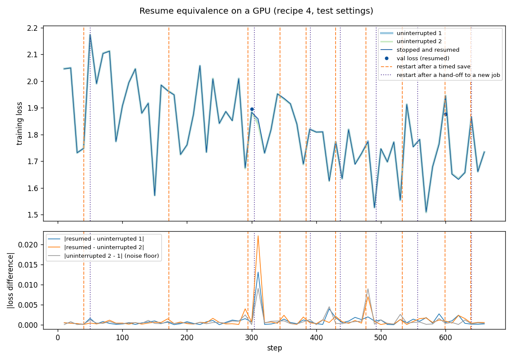

# Recipe 4: fine-tune a language model on the OSPool

This recipe teaches a 1.5-billion-parameter language model (Qwen2.5-1.5B) to follow instructions, on one GPU borrowed from the OSPool. The OSPool lends unused computers all over the country. They can disappear at any time, often **without warning**. This recipe shows how a training job survives that, and how it keeps going for as long as it needs to.

It uses **LoRA**: instead of changing the model's 1.5 billion weights, it trains about 18 million new ones (small "adapters"). So the checkpoint is small, 222 MB (the adapters plus the optimizer's memory of them), which is what makes the OSPool practical.

## The files

| File | What it is |
|---|---|
| [`train.py`](train.py) | The training program. Seven numbered sections, listed at the top of the file. |
| [`config.yaml`](config.yaml) | All the settings, with comments. |
| [`settings.sub`](settings.sub) | **Your three settings** (where your model and container are). The only file you edit. |
| [`job_ospool.sub`](job_ospool.sub) | The submit file. Reads `settings.sub`. |
| [`recipe4.dag`](recipe4.dag) | Keeps training going in new jobs, past your access point's time limit (see below). |
| [`handoff.sh`](handoff.sh) | The DAG's helper: what to do after each job. |
| [`prepare_data.py`](prepare_data.py), [`prepare.sub`](prepare.sub) | Run once: download the model and the dataset. |
| [`container.def`](container.def), [`requirements.txt`](requirements.txt) | The software (PyTorch, transformers, peft). |
| [`test_local.py`](test_local.py) | Tests on your laptop, with a tiny model. |
| [`test_htcondor.sh`](test_htcondor.sh) | Tests on HTCondor: interrupts a real job in each possible way. |
| [`compare_runs.py`](compare_runs.py) | Compares the losses of interrupted runs with uninterrupted ones (from recipe 1). |

## How the job survives

A job on the OSPool can be stopped in several ways. For each, the job saves its progress first (or has saved recently), and then continues:

| What happens | Warning? | What the job does | Exit code |
|---|---|---|---|
| **Our timer** (every 5 h) | – | saves, asks to be restarted | 85 |
| **The glidein ends** (the borrowed computer is given back) | **no** | reads the end time at start-up and saves 15 min before it | 85 |
| **HTCondor evicts the job** (`condor_vacate_job`, `condor_hold`) | SIGTERM, 10 min before the kill | finishes the current step, saves | 85 |
| **A crash or hard kill** | no | nothing: restarts from the last save | – |
| **The access point's limit per run** (20 h on ap40) | – | nothing needed: every exit 85 starts a new run, and the timer comes first | – |
| **The access point's limit per job** (14 days on ap40) | – | reads the deadline at start-up, saves 15 min before it, and asks for a **new job** | 86 |
| **Training is done** | – | exports the adapters | 0 |

Exit 85 means "restart me": HTCondor restarts the job, usually on the same computer within seconds. Exit 86 means "continue in a new job": the DAG takes care of it.

Every row was measured on the OSPool. The numbers are in [`docs/environment.md`](../../docs/environment.md) §10 (for example: 5 of 5 glidein ends came with no warning, 2–6 minutes after their announced end time).

## What's in a checkpoint

| Saved | Why |
|---|---|
| the LoRA adapters | the thing being trained |
| the optimizer's state | without it, the loss jumps after every restart |
| step, epoch, position in the data | so no example is repeated or skipped |
| random-number states | so a resumed run behaves like an uninterrupted one |
| which base model it was | adapters only work on the model they were trained with |
| the training log (`metrics.jsonl`) | one continuous record across all restarts and jobs |

**Not saved: the base model.** It never changes, so every job simply receives it again as input. That keeps the checkpoint small.

## Where the files live

This follows the OSPool's data guide: small files next to your submit file, large ones in your access point's OSDF area.

| What | Size | Where |
|---|---|---|
| code, settings, `data/` | a few MB | next to the submit file (your home directory) |
| the base model | 3 GB | your OSDF area: `/ospool/ap40/data/<user>/recipe4/models/` |
| the container | ~6 GB | your OSDF area: `.../recipe4/containers/` |
| checkpoints | 222 MB (measured) | HTCondor keeps them on the access point while the job runs |
| the trained adapters | ~75 MB (estimated) | come back to `outputs/` next to the submit file |

Two things worth knowing (both measured):
- **Files read through OSDF don't count against your access point's input limit** (5 GB on ap40). Files sent from your home directory do, and so does a checkpoint after an eviction. That's why the base model goes through OSDF and why the checkpoint must stay small.
- **OSDF remembers files by name.** If you change a file, give it a new name (`-v2`).

## Run it

1. **Build the container** from [`container.def`](container.def), where your site allows builds:
   ```
   apptainer build recipe4-v1.sif container.def
   mv recipe4-v1.sif /ospool/ap40/data/<user>/recipe4/containers/
   ```
2. **Edit the three lines** in [`settings.sub`](settings.sub): your OSDF area, the model's name, the container's name. Both submit files read them, so you edit them only once, and updating the submit files later won't erase them.
3. **Download the model and the data** (a CPU job, about 15 minutes):
   ```
   condor_submit prepare.sub
   ```
   When it's done, the model is in your OSDF area and `data/` is here.
4. **Copy the shared checkpointing code** next to the submit file:
   ```
   cp -r ../../htcondor_ckpt .
   ```
5. **Start training**, through the DAG (recommended):
   ```
   condor_submit_dag recipe4.dag
   ```
   or as a single job: `mkdir -p resume && condor_submit job_ospool.sub`.
6. **Watch it:** `job.out` collects the output of every run. Look for these lines:
   - `TIME LIMIT for this run: …`: when it will stop, and why;
   - `SAVED step …`, `EXIT 85`: a checkpoint;
   - `RESUMED from step …`: a restart that picked up where it left off;
   - `DONE`: finished. The adapters are in `outputs/final_adapter/` (and the best ones in `outputs/best_adapter/`).

## Running longer than 14 days: the DAG

Some access points limit how long one job may exist: ap40 allows a checkpointing job 14 days in total, and then puts it on hold. To train longer, the work has to move to a **new job**. HTCondor deletes a job's saved checkpoints when the job leaves the queue, so the old job must hand its checkpoint over first:

```
job 1 trains ... 15 min before its limit: saves, exits 86
   → the checkpoint comes back here (checkpoints/)
   → handoff.sh moves it to resume/
   → the DAG submits the same job again: job 2, with a fresh limit
job 2 starts, finds resume/, continues from the same step ... and so on
the last job finishes: exit 0 → the DAG is done
```

A job reads its own deadline at start-up (`JobStartDate + AllowedJobDuration` in its job ad), so nothing needs to be set by hand. If the job fails with any other exit code, the DAG stops instead of trying again.

**Can this go on forever?** The DAG itself isn't subject to the 14-day limit (it runs on the access point, not as a training job). `RETRY train 50` allows up to 50 new jobs; raise it if you need more. Before running for months, ask your access point's support team: the limit exists to share the OSPool fairly.

## The submit-file lines that matter

```
checkpoint_exit_code      = 85
transfer_checkpoint_files = checkpoints
when_to_transfer_output   = ON_EXIT_OR_EVICT
transfer_output_files     = checkpoints, outputs
kill_sig                  = SIGTERM
shell                     = export HOME=$PWD; mkdir -p checkpoints outputs; exec python3 train.py --config config.yaml --set model_dir=$(MODEL)
```

- **`checkpoint_exit_code = 85`:** exit 85 means "restart me". Without it, exit 85 just ends the job.
- **`ON_EXIT_OR_EVICT` and `transfer_output_files`:** without both, the save made after a SIGTERM is thrown away.
- **`exec`:** HTCondor sends SIGTERM only to the job's top process. `exec` makes Python that process.
- **`mkdir -p checkpoints outputs`:** the directories HTCondor copies back must exist, even if `train.py` fails at start-up. Without them the job goes on hold for a missing directory, which hides the real error.
- **`request_cpus = 2`:** training uses about one CPU. Some access points hold jobs that use many more CPUs than they asked for.

Every line in [`job_ospool.sub`](job_ospool.sub) has a comment. Your own settings live in [`settings.sub`](settings.sub), which it reads with `include : settings.sub`.

## Test it

**On your laptop** (no GPU, no download, about a minute):
```
pip install torch==2.8.0 -r requirements.txt
python3 test_local.py
```
It checks, with a tiny random model:
- a run stopped three times with SIGTERM ends with **exactly** the same losses as an uninterrupted run;
- the timer, the glidein end and the per-job limit each make the job save and exit (85, 85 and 86);
- after an exit 86, `handoff.sh` moves the checkpoint, and the next job continues to the same losses;
- a different base model is refused.

**On HTCondor** (each test is a short run, 10–20 minutes of one GPU):
```
./test_htcondor.sh timed      # timed checkpoints only
./test_htcondor.sh vacate     # SIGTERM: resumes from the save made after it
./test_htcondor.sh hold       # hold and release: the same
./test_htcondor.sh fast       # a kill with no warning: resumes from the last timed checkpoint
./test_htcondor.sh handoff    # the DAG, with the per-job limit shrunk to 7 minutes
```
Each prints the job's `SAVED` and `RESUMED` lines and PASS or FAIL. Use `nohup ... > x_run.txt 2>&1 &` to keep one running after you log out.

**Do interrupted runs train the same as uninterrupted ones?** Run `reference` twice, then compare (it also draws the plot, if matplotlib is installed):
```
python3 compare_runs.py --reference test_reference_<time>/checkpoints --reference test_reference_<other time>/checkpoints \
                        --resumed test_handoff_<time>/checkpoints --plot resume_equivalence_gpu.png
```
The two references show how much two identical runs differ on GPUs; an interrupted run should differ by no more than that.

## Measurements

From the HTCondor tests on the OSPool (2026-10-27, six test runs; the jobs ran on NVIDIA A40, A100, H100 and RTX A5000 GPUs):

| | Value |
|---|---|
| trained parameters | 18.5M of 1,562M (1.2%) |
| checkpoint | **222 MB**, 2 files |
| save time | 0.4–1.6 s (usually ~0.5 s) |
| peak GPU memory | **19.0 GB** on every GPU type (`gpus_minimum_memory = 24000`) |
| peak host memory | 6.3 GB (`request_memory = 10GB`) |
| CPUs used | about 0.9 (`request_cpus = 2`) |
| start-up, process start to first step | 9–18 s |
| one timed checkpoint (save + restart in place) | ~23 s: **0.13% of a 5 h interval** |
| restart after an eviction or hold (a new machine) | 4–13 min |
| hand-off to a new job (exit 86 → the next job's first step) | 2.5–13 min, typically ~4 min (7 hand-offs) |
| interrupted runs vs. two uninterrupted ones | validation loss within 0.0007; the two uninterrupted runs differ by 0.0003 |

The last row is the size of normal run-to-run differences on GPUs: GPU calculations aren't exactly repeatable, and the runs used different GPU types. On a CPU, interrupted runs match exactly (the local tests).



The hand-off test above restarted 17 times: 10 timed checkpoints, and 7 hand-offs to a new job (dotted lines), on four kinds of GPUs. Its losses lie on top of the two uninterrupted runs. The bottom panel shows the differences: the gaps between the resumed run and either uninterrupted run are the same size as the gap between the two uninterrupted runs (grey), including the bump near step 310. So the restarts lose or repeat nothing. All five interrupted tests passed the same comparison (`compare_runs.py`).

## Using it for your own model

- **Another base model:** `prepare_data.py --model <name>`. Check `lora_targets` in `config.yaml` against the model's layer names.
- **Your own data:** change section 2 of `prepare_data.py`. Anything that ends up as blocks of token ids works.
- **Keep the checkpoint small:** bigger `lora_r` means bigger adapters. If the checkpoint ever grows past ~1 GB, read the input-limit note above first.
- **Keep `exec`** in the `shell` line, and **keep the checkpoint directory listed** in the submit file.
